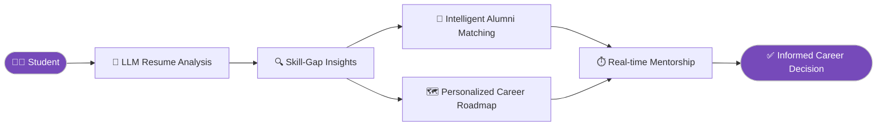
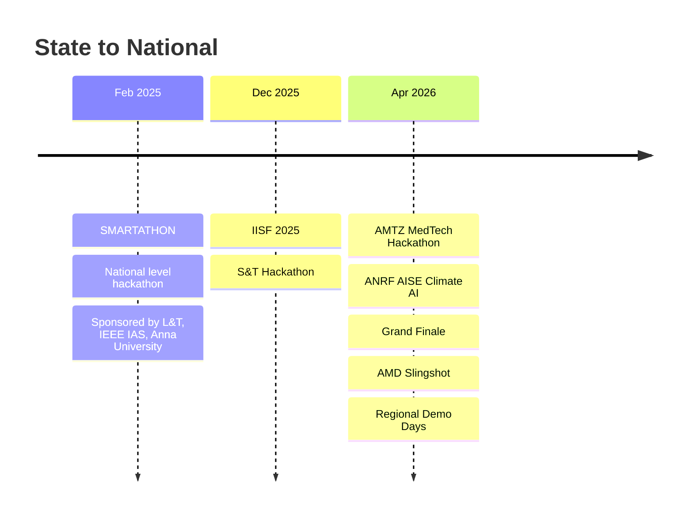

<div align="center">


<a href="https://github.com/Kabil0x">
  
</a>

<br/>

<a href="mailto:kabilanmurali06@gmail.com"></a>
<a href="https://kabilanportfolio.web.app"></a>
<a href="https://linkedin.com/in/kabilan-murali"></a>


<br/><br/>


</div>

<br/>

## 🧬 Agent State

> My profile, modelled the way I build agents: as a state object.

```python
class Kabilan:
    role      = "AI Full Stack Developer"
    focus     = ["Agentic AI", "RAG pipelines", "LLM applications"]
    stack     = ["LangChain", "LangGraph", "Vector DBs", "React", "Python", "Java"]
    proof     = ["CareerMate AI", "MSME 3.0 Leaf Grading", "5 hackathons"]
    status    = "Open to internships, collaborations & hackathon teams"

    def philosophy(self):
        return "Ship the agent. Then make it smarter."
```

<br/>

## 🎯 Flagship: CareerMate AI

<div align="center">

**Smart Career Development Hub** &nbsp;·&nbsp; *Communex*

</div>

One ecosystem that unifies **career planning**, **alumni networking**, and **mentorship**, powered by LLMs. This is where "agentic AI" stopped being a buzzword and became something people can use.



| Capability | What it does |
|---|---|
| 📄 **Resume intelligence** | LLM-based analysis that reads beyond keywords |
| 🤝 **Alumni matching** | Connects students to the *right* mentor, not just any mentor |
| 🗺️ **Career roadmaps** | Plans built around each student's real skill gaps |
| ⏱️ **Live mentorship** | Real-time guidance and skill-gap insights |

<br/>

## ⚙️ Toolkit

<div align="center">

| Layer | Stack |
|:---:|:---|
| 🧠 **Agentic AI** |      |
| 💻 **Languages** |  |
| 🌐 **Web** |  |
| 🗄️ **Databases** |  |
| 🛠️ **Tools** |   |

</div>

<br/>

## 🧪 Hardware Meets Machine Learning

### 🌿 Ayurvedic Leaf Grading System
`MSME 3.0` · `Government of India–funded`

Python ML models for **image-based leaf classification**, paired with a **Raspberry Pi** for real-time data processing and system control. Software and hardware, working as one system.


<br/>

## 🏁 Hackathon Trail



<br/>

## 🕸️ How I Got Here

Every step fed the next one, the way nodes pass state in LangGraph.

```mermaid
flowchart LR
    A([🌐 Full Stack Foundations<br/>HTML · CSS · JS · React]):::n --> B([🤖 ML → DL → LLMs]):::n
    B --> C([📚 RAG + Vector DBs]):::n
    C --> D([🧩 LangChain · LangGraph]):::n
    D --> E([🚀 CareerMate AI<br/>shipped]):::ship
    E --> F([🏆 Hackathon Circuit]):::n
    F -.next.-> G([🔮 Production-grade<br/>Agentic Systems]):::next

    classDef n fill:#1B263B,stroke:#7AA2F7,color:#ffffff,stroke-width:1.5px;
    classDef ship fill:#764ABA,stroke:#C0C0C0,color:#ffffff,stroke-width:2px;
    classDef next fill:#0D1B2A,stroke:#C0C0C0,color:#C0C0C0,stroke-dasharray:5 5;
```



```text
2025-05 ┬─ Generative AI & Agentic AI Trainee ── DigiDARA Technologies   [3 months]
        │    ├─ ML → DL → LLMs → RAG → Vector DBs → LangChain / LangGraph
        │    └─ ✅ Designed & developed CareerMate (student ⇄ alumni AI agent)
        │
2025-06 ┴─ Full Stack Web Dev Intern ──────── ATS Accent Techno Soft     [2–18 Jun]
             └─ ✅ Built web app components: HTML · CSS · JS + backend integration
```

<br/>

## 📜 Certifications

<div align="center">


</div>

<br/>

## 📊 Activity

<div align="center">


<br/>


</div>

<br/>

## 📬 Let's Build Something

<div align="center">

**Agents, RAG pipelines, hackathon teams, or just trading war stories. My inbox is open.**

<a href="mailto:kabilanmurali06@gmail.com"></a>
<a href="https://linkedin.com/in/kabilan-murali"></a>
<a href="https://kabilanportfolio.web.app"></a>
<a href="https://github.com/Kabil0x"></a>


</div>
